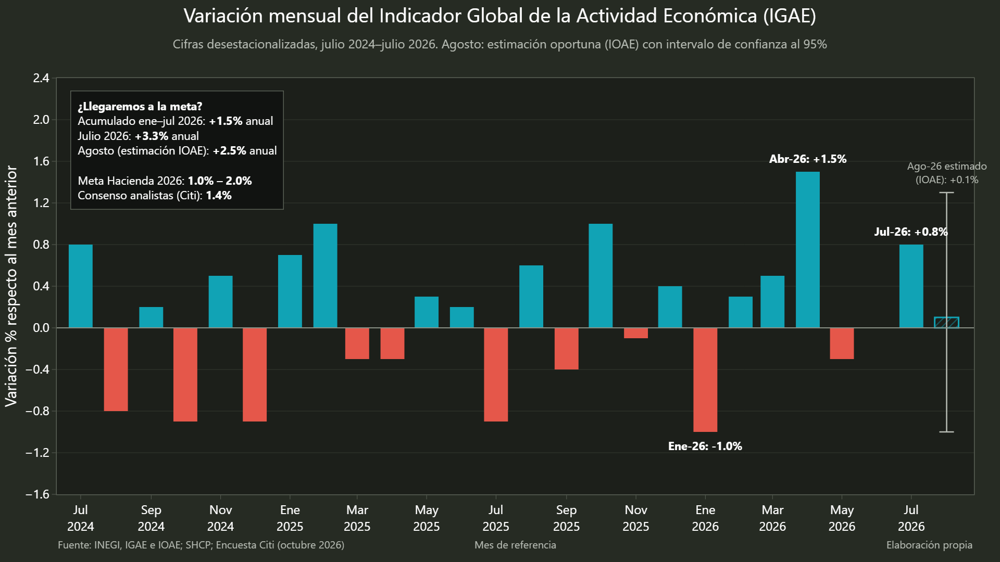
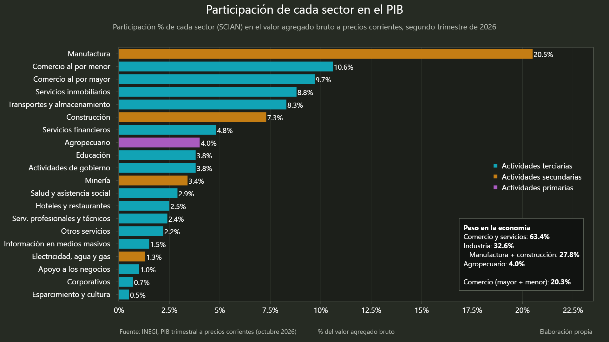
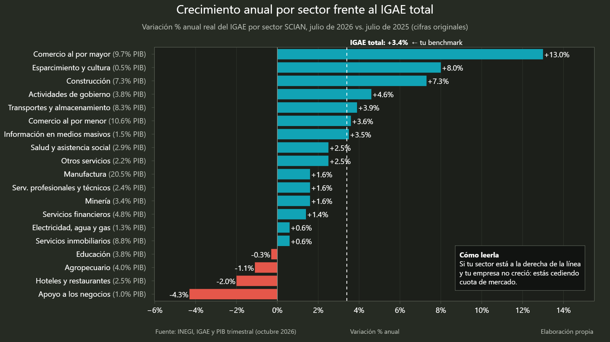
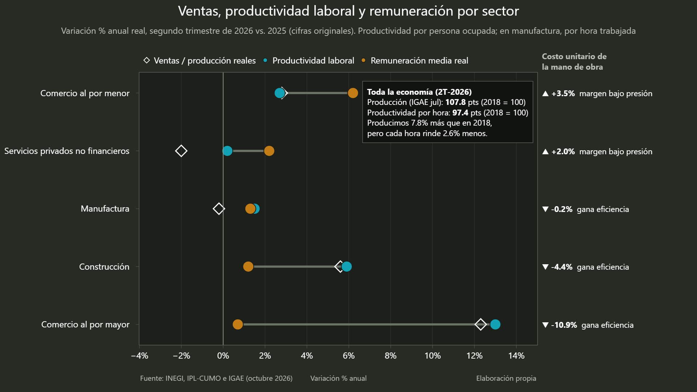

# Análisis de la economía mexicana con Python

Análisis del Indicador Global de la Actividad Económica (IGAE) de julio de 2026, combinado con el peso de los sectores en el PIB y con indicadores de productividad laboral y costo unitario de la mano de obra.

El análisis se realizó con Python, pandas y Plotly. Los datos fueron transcritos de los boletines oficiales del INEGI y las gráficas se generan desde [`graficas_igae.py`](./graficas_igae.py).

## Resultados principales

- La economía acumuló **1.5% de crecimiento de enero a julio de 2026**.
- En julio, el IGAE creció **0.8% mensual** y **3.3% anual**, en cifras desestacionalizadas.
- Las actividades terciarias representan **63.4% del valor agregado**; manufactura y construcción representan **27.8%**.
- El comercio mayorista creció **13.0% anual** y la construcción **7.3%**. La manufactura, pese a representar **20.5% del PIB**, creció **1.6%**.
- México produce **7.8% más que en 2018**, pero la productividad por hora trabajada se encuentra **2.6% por debajo** de ese año.
- En el comercio minorista, las remuneraciones reales crecieron **6.2%** frente a **2.7% de productividad**; el costo laboral unitario aumentó **3.5%**.

## Gráficas e interpretación

### 1. Pulso mensual del IGAE



La actividad económica muestra variaciones mensuales irregulares. El dato de julio, **+0.8%**, confirma una recuperación mensual, pero no basta por sí solo para afirmar que existe una aceleración sostenida.

### 2. Peso de los sectores en el PIB



El crecimiento agregado depende principalmente de las actividades terciarias. Por eso, un buen desempeño del comercio y los servicios puede sostener el resultado total aunque sectores industriales relevantes avancen poco.

### 3. Crecimiento anual por sector



El comercio mayorista y la construcción lideran el crecimiento anual de julio. La manufactura queda por debajo del IGAE total, lo que limita la calidad del crecimiento porque se trata de uno de los sectores con mayor peso económico.

### 4. Productividad frente a costo laboral



El aumento de remuneraciones no siempre está acompañado por un aumento equivalente de productividad. En el comercio minorista, esta brecha eleva el costo laboral por unidad y presiona los márgenes.

## Reproducibilidad

```bash
python -m venv .venv
.venv/Scripts/activate        # macOS/Linux: source .venv/bin/activate
pip install -r requirements.txt
python graficas_igae.py
```

El notebook [`analisis_igae_python.ipynb`](./analisis_igae_python.ipynb) documenta el análisis paso a paso.

## Estructura pública

| Archivo o carpeta | Contenido |
|---|---|
| `analisis_igae_python.ipynb` | Notebook del análisis |
| `graficas_igae.py` | Código de las cuatro gráficas |
| `data/` | Datos utilizados en el análisis |
| `imgs/` | Gráficas finales incluidas arriba |
| `requirements.txt` | Dependencias de Python |

## Fuentes

- INEGI. [IGAE, julio de 2026](https://www.inegi.org.mx/contenidos/saladeprensa/boletines/2026/igae/igae2026_09.pdf), boletín 603/26.
- INEGI. [IOAE, agosto de 2026](https://www.inegi.org.mx/contenidos/saladeprensa/boletines/2026/ioae/ioae2026_09.pdf), boletín 597/26.
- INEGI. [PIB trimestral a precios corrientes, 2T de 2026](https://www.inegi.org.mx/contenidos/saladeprensa/boletines/2026/pibt/pib_Pcorr2026_08.pdf), boletín 501/26.
- INEGI. [Productividad laboral y costo unitario de la mano de obra, 2T de 2026](https://www.inegi.org.mx/contenidos/saladeprensa/boletines/2026/iplcumo/iplcumo2026_09.pdf), boletín 589/26.
